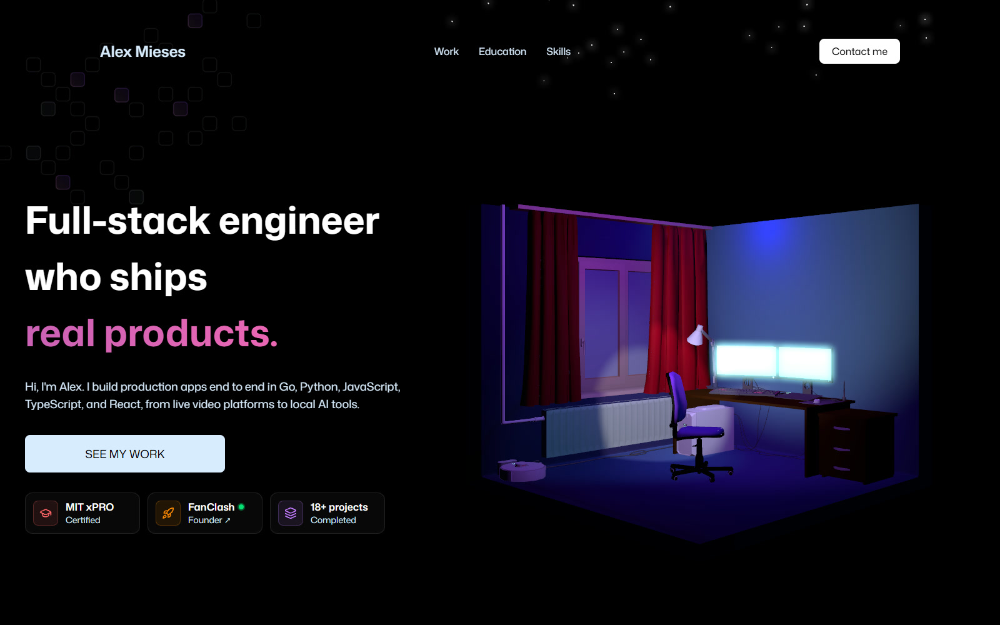
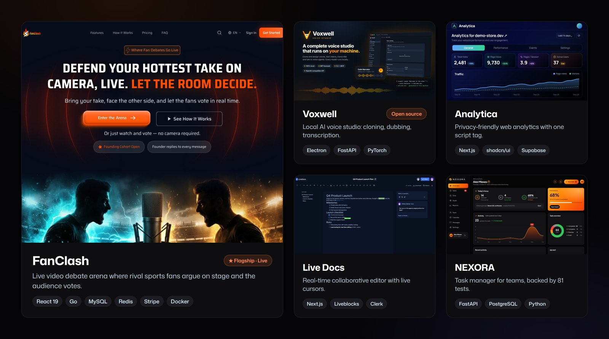

<div align="center">
  <a href="https://www.alexportfolio.net/">
    
  </a>
  <br />

  <div>
    
    
    
    
    
    
    
    
    
    
    
  </div>

  <h3 align="center">Alex Mieses · 3D Developer Portfolio</h3>

  <p align="center">
    <a href="https://www.alexportfolio.net/"><b>Live site</b></a> ·
    <a href="https://www.alexportfolio.net/#work">Selected work</a> ·
    <a href="https://www.alexportfolio.net/#contact">Contact</a> ·
    <a href="https://www.linkedin.com/in/alexmieses">LinkedIn</a>
  </p>
</div>

##  Table of Contents

1.  [About](#about)
2.  [Selected Work](#selected-work)
3.  [Features](#features)
4.  [Tech Stack](#tech-stack)
5.  [Project Structure](#project-structure)
6.  [Quick Start](#quick-start)
7.  [Deployment](#deployment)

##  <a name="about">About</a>

This is the source for [alexportfolio.net](https://www.alexportfolio.net/), my personal portfolio. I'm a full-stack engineer, the founder of [FanClash](https://fanclash.io), and an MIT xPRO certified developer. I build production apps end to end in Go, Python, TypeScript, and React.

The site is a single landing page built around an interactive 3D room you can rotate and zoom, followed by my projects, education, tech stack, and a working contact form.

##  <a name="selected-work">Selected Work</a>



| Project | What it is | Stack | Links |
|---|---|---|---|
| **FanClash** | Live video debate arena where rival sports fans argue on stage and the audience votes on a winner | React 19, Go, MySQL, Redis, Stripe, Docker | [Live](https://fanclash.io) |
| **Voxwell** | Open-source voice studio that runs entirely on your machine: voice cloning, dubbing, transcription, and voice agents | React 19, Electron, Python, FastAPI, PyTorch | [GitHub](https://github.com/Troy2727/voxwell) · [Live](https://voxwell.vercel.app) |
| **Analytica** | Privacy-friendly web analytics with one script tag, real-time events, and Discord alerts | Next.js, shadcn/ui, Supabase | [GitHub](https://github.com/Troy2727/analytica) · [Live](https://analytica-phi.vercel.app) |
| **Live Docs** | Real-time collaborative editor with live cursors, comments, sharing, and version history | Next.js, TypeScript, Liveblocks, Clerk | [GitHub](https://github.com/Troy2727/coedit_flow) · [Live](https://coeditflow.vercel.app) |
| **NEXORA** | Task manager for teams with a kanban board, goals, reports, and chat, backed by an 81-test pytest suite | Python, FastAPI, PostgreSQL | [GitHub](https://github.com/Troy2727/NEXORA) · [Live](https://nexora-five-dun.vercel.app) |

##  <a name="features">Features</a>

👉 **Interactive 3D hero**: a lit 3D room with floating particles, built with React Three Fiber. Drag to rotate, scroll to zoom.

👉 **First-screen pitch**: headline, intro, call to action, and proof (MIT xPRO, FanClash, 18+ projects) all visible without scrolling.

👉 **Scroll animations**: GSAP and ScrollTrigger reveal the project cards, the education timeline, and the tech stack as you scroll.

👉 **Animated counters** for years of experience and completed projects.

👉 **Working contact form** that sends messages through EmailJS, next to a 3D desk scene.

👉 **Mobile first**: only one 3D canvas is mounted per breakpoint, and the layout is checked at phone, tablet, and desktop widths.

##  <a name="tech-stack">Tech Stack</a>

<p align="center">
  <a href="docs/diagrams/architecture-dark.svg" title="Open this diagram full size">
    
  </a>
</p>

- **UI:** React 19, Vite, Tailwind CSS v4
- **3D:** Three.js, React Three Fiber, Drei, React Three Postprocessing
- **Animation:** GSAP with ScrollTrigger
- **Contact:** EmailJS
- **Quality:** ESLint, GitHub Actions (lint and build on every push and pull request)
- **Hosting:** Vercel

##  <a name="project-structure">Project Structure</a>

```
src/
├── sections/       # Page sections in order: Hero, ShowcaseSection, FeatureCards,
│                   # Experience, TechStack, Contact, Footer
├── components/     # NavBar, Button, TitleHeader, AnimatedCounter, GlowCard
│   └── models/     # 3D scenes: hero room, contact desk, tech logos
├── constants/      # Copy and data: nav links, counters, education, tech stack, socials
├── hooks/
└── index.css       # Tailwind theme and section styles
public/
├── images/         # Project cards, logos, icons
└── models/         # Compressed .glb 3D models
```

##  <a name="quick-start">Quick Start</a>

**Prerequisites:** [Git](https://git-scm.com/) and [Node.js](https://nodejs.org/en) 20 or newer.

```bash
git clone https://github.com/Troy2727/3D_Developer_Portfolio.git
cd 3D_Developer_Portfolio
npm install
```

**Environment variables**

The contact form needs an [EmailJS](https://www.emailjs.com/) account. Create a `.env` file in the project root:

```env
VITE_APP_EMAILJS_SERVICE_ID=
VITE_APP_EMAILJS_TEMPLATE_ID=
VITE_APP_EMAILJS_PUBLIC_KEY=
```

Everything except sending messages works without them.

**Run it**

```bash
npm run dev       # dev server at http://localhost:5173
npm run lint      # ESLint
npm run build     # production build in dist/
npm run preview   # serve the production build
```

##  <a name="deployment">Deployment</a>

Every push to `main` runs the CI workflow (`npm ci`, lint, build) and deploys to production on Vercel at [alexportfolio.net](https://www.alexportfolio.net/). Set the three EmailJS variables in the Vercel project settings.

##  Acknowledgements

The original 3D layout started from the JavaScript Mastery 3D portfolio tutorial. The content, projects, copy, and design changes are my own.
